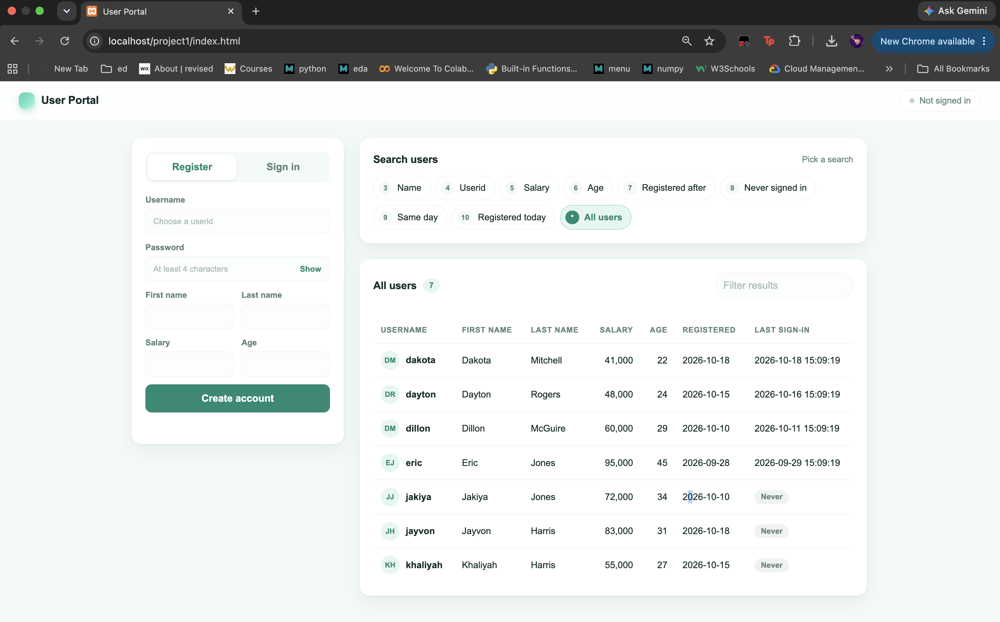
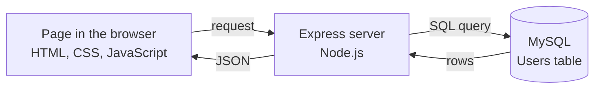

# User Portal


A small web app where people can **register**, **sign in**, and **search a table of users** in eight different ways.

[Quick start](#quick-start) · [Features](#features) · [Stages](#stages) · [Behind the scenes](#behind-the-scenes) · [Collaboration](#collaboration)



## How it fits together



Click a button, the page asks the server, the server asks the database, and the answer comes back as a table.

## Quick start

You need Node.js, Git and XAMPP (MySQL).

```bash
git clone https://github.com/rifahtas/DSE-6.1k-Project-1.git
cd DSE-6.1k-Project-1
```

1. Start **MySQL** in XAMPP.
2. Open <http://localhost/phpmyadmin>, choose **Import**, pick `setup.sql` and click **Go**. This creates the `web_app` database, the `Users` table and seven sample users.
3. Start the server:
   ```bash
   cd Backend
   cp dotenv.txt .env
   npm install
   npm start
   ```
   You should see `I am listening on port 5050` and `db connected`.
4. In a second terminal tab, open the page:
   ```bash
   open Frontend/index.html
   ```

<details>
<summary>What goes in <code>.env</code></summary>

```
PORT=5050
DB_USER=root
PASSWORD=
DATABASE=web_app
DB_PORT=3306
HOST=localhost
```

Add your MySQL password after `PASSWORD=` if you have one. `.env` is ignored by Git.
</details>

<details>
<summary>Something not working?</summary>

| Problem | Fix |
|---|---|
| `ECONNREFUSED` | MySQL isn't running in XAMPP. If it keeps happening, set `HOST=127.0.0.1` in `.env` |
| `ER_BAD_DB_ERROR` | The `DATABASE` value in `.env` doesn't match your database name |
| `Access denied for user 'root'` | Put your MySQL password after `PASSWORD=` |
| `EADDRINUSE` | Port 5050 is busy: `kill -9 $(lsof -t -i:5050)` |
| Page says "Failed to fetch" | The server isn't running; run `npm start` in `Backend/` |
</details>

## Features

All sample users have the password `1234`. Here is what to try and what you should get back.

| # | Feature | Try this | You should get |
|---|---|---|---|
| 1 | Register | any new username | a "Welcome" message |
| 2 | Sign in | `dillon` / `1234` | "Welcome back, Dillon!" |
| 3 | Search by name | last name `jones` | eric, jakiya |
| 4 | Search by userid | `dillon` | dillon |
| 5 | Salary between X and Y | 50000 to 80000 | khaliyah, dillon, jakiya |
| 6 | Age between X and Y | 20 to 30 | dakota, dayton, khaliyah, dillon |
| 7 | Registered after a user | `dillon` | dayton, khaliyah, dakota, jayvon |
| 8 | Never signed in | no input | jakiya, jayvon, khaliyah |
| 9 | Registered the same day as a user | `dillon` | jakiya |
| 10 | Registered today | no input | dakota, jayvon |

"After" compares registration dates, so it means a later day. The "same day" search leaves out the user you picked. The dates in `setup.sql` are relative to the day you import it, so these results stay the same.

Try it yourself:

- [ ] Register a new user and find them with "Registered today"
- [ ] Sign in as your new user and check that they leave the "Never signed in" list
- [ ] Sort the results table by clicking a column header
- [ ] Type `' OR '1'='1` as a username and watch the sign-in fail

## Stages

`Frontend/stages` keeps earlier versions of the page, one folder per stage, each adding one feature. They all use the same server, so you can open them side by side as browser tabs:

```bash
open Frontend/stages/stage-*/index.html Frontend/index.html
```

| Page | Adds |
|---|---|
| [`stage-1`](Frontend/stages/stage-1) | all users table |
| [`stage-2`](Frontend/stages/stage-2) | registration |
| [`stage-3`](Frontend/stages/stage-3) | sign-in |
| [`stage-4`](Frontend/stages/stage-4) | searches 3 to 6 |
| [`stage-5`](Frontend/stages/stage-5) | searches 7 to 10 |
| [`Frontend/index.html`](Frontend/index.html) | final design |

The tags `stage-1-show-all` to `stage-6-design` mark the same steps in the code. `git checkout stage-3-signin` shows the backend at that point, and `git checkout main` brings you back.

## Behind the scenes

<details>
<summary>Which route and function handles each feature</summary>

| # | Route (`Backend/app.js`) | Function (`Backend/dbService.js`) | SQL idea |
|---|---|---|---|
| 1 | `POST /register` | `registerUser` | `INSERT` |
| 2 | `POST /signin` | `signIn` | `SELECT`, `UPDATE` |
| 3 | `GET /search/name` | `searchByName` | `LIKE` |
| 4 | `GET /search/userid/:username` | `searchByUsername` | `WHERE =` |
| 5 | `GET /search/salary` | `searchBySalary` | `BETWEEN` |
| 6 | `GET /search/age` | `searchByAge` | `BETWEEN` |
| 7 | `GET /search/after/:username` | `registeredAfter` | subquery |
| 8 | `GET /search/never-signed-in` | `neverSignedIn` | `IS NULL` |
| 9 | `GET /search/same-day/:username` | `registeredSameDay` | subquery |
| 10 | `GET /search/today` | `registeredToday` | `CURDATE()` |

Every statement is also listed in `sql.txt`.
</details>

<details>
<summary>Passwords and SQL injection</summary>

Passwords are saved as salted hashes, not as plain text, and no route ever sends the password column back.

A common attack is typing `' OR '1'='1` into the username box so the database logs the attacker in. That only works when typed text is pasted into the SQL. Here every query uses `?` placeholders, so the typed text is treated as a username that doesn't exist, and the sign-in fails.
</details>

<details>
<summary>Project files</summary>

```
Backend/
  app.js            routes
  dbService.js      database queries
  dotenv.txt        template for .env
  package.json
Frontend/
  index.html, index.js, stylesheet.css    final page
  stages/stage-1 ... stage-5              earlier versions
docs/screenshot.png
setup.sql           creates the Users table and sample users
sql.txt             all SQL statements
```
</details>

## Collaboration

We share work through GitHub:

| Command | What it does |
|---|---|
| `git clone` | copy the remote repo to your computer |
| `git fetch` | check what is new on GitHub without changing your files |
| `git pull` | fetch and bring the changes into your files |
| `git add`, `git commit` | save a change on your computer |
| `git push` | send your commits to GitHub |

Her changes appear in the commit history.

## Contributors

- [@rifahtas](https://github.com/rifahtas)
- [@most-afroz](https://github.com/most-afroz)
